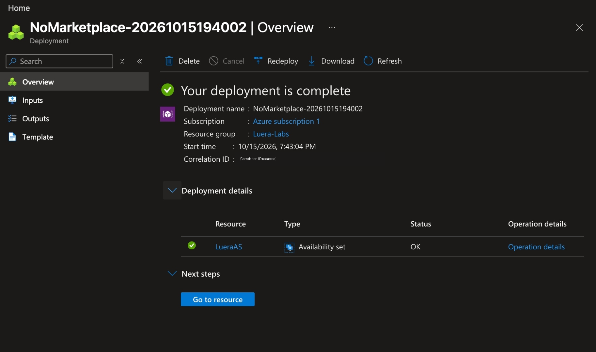
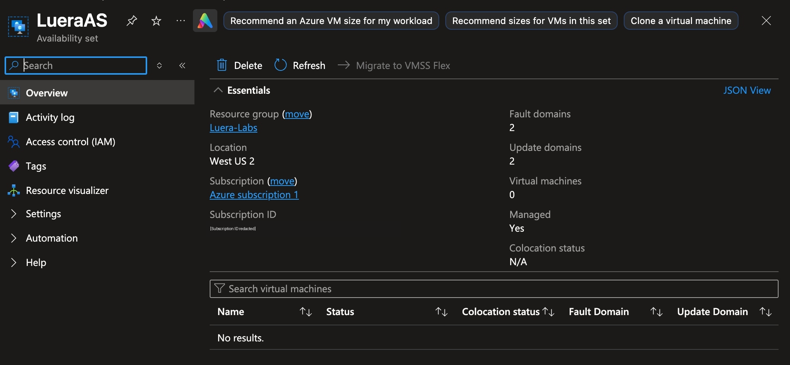
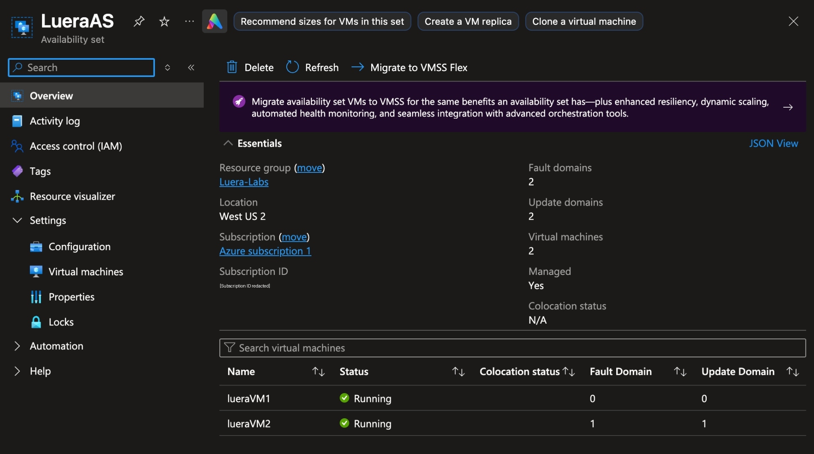
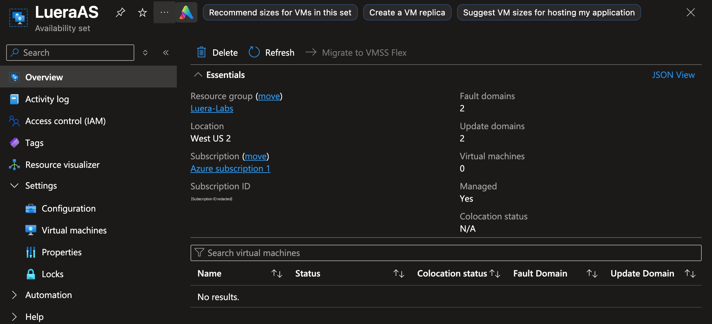

# Azure Availability Set Deployment and Verification

Date: October 15, 2026

Status: Completed. Deployment, VM placement, and VM cleanup documented below.

## Objective

Create an availability set with two fault domains and two update domains, deploy two VMs into it, and verify their assigned domains using the Azure portal.

## Lab Environment

| Component | Configuration |
|---|---|
| Cloud platform | Microsoft Azure |
| Resource group | `Luera-Labs` |
| Region | West US 2 |
| Availability set | `LueraAS` |
| Fault domains | 2 |
| Update domains | 2 |
| Managed | Yes |
| VMs | `lueraVM1`, `lueraVM2` |
| Deployment method | Azure portal |

## 1. Created the Availability Set

Created `LueraAS` and confirmed that the deployment completed successfully.

## 2. Verified the Initial Configuration

Confirmed two fault domains, two update domains, and zero attached VMs before deploying the virtual machines.

## Troubleshooting: Missing Availability Set Option

The newer VM creation layout did not show Availability set in the Availability options dropdown. Standard security and West US 2 were selected, but the option was still absent.

Switched to the original VM creation layout using the option provided in the portal. Availability set became available, allowing selection of `LueraAS`. No CLI was used.

This documents the behavior encountered during this lab; it does not establish a platform-wide cause or limitation.

## 3. Deployed Two VMs and Verified Placement

Deployed `lueraVM1` and `lueraVM2` into `LueraAS`. Confirmed that both were running and assigned to separate fault domains and update domains.

| VM | Observed status | Fault domain | Update domain |
|---|---|---|---|
| `lueraVM1` | Running | 0 | 0 |
| `lueraVM2` | Running | 1 | 1 |

## 4. Cleanup

Deleted `lueraVM1` and `lueraVM2` after placement verification. Confirmed that `LueraAS` showed zero VMs afterward. Retained the availability set.

Deletion of associated disks, network interfaces, and public IP addresses was not verified.

## Lessons Learned and Limitations

- Verified actual VM domain assignments rather than assuming placement.
- Switching to the original portal layout resolved the missing selection option in this lab.
- Captured configuration, placement, and cleanup evidence before deleting the VMs.
- This lab verified deployment and placement only. Hardware failure, planned platform maintenance, application redundancy, and automatic failover were not tested.
