# Azure VM Scale Set and Autoscale Lab

Date: October 17, 2026

Status: Completed. Deployment, autoscale configuration, and one observed scale-out and scale-in cycle documented below. Cleanup not documented.

## Objective

Deploy a Windows VM Scale Set with CPU-based autoscale rules, confirm the deployment and running instances, and review the autoscale run history to see what the scale set actually did. Completed while studying Azure fundamentals through CBT Nuggets.

## Lab Environment

| Component | Configuration |
|---|---|
| Cloud platform | Microsoft Azure |
| Scale set | `vmss-lab-01` |
| Region | Central US |
| Orchestration mode | Uniform |
| Availability zones | 1, 2, 3 |
| Image | Windows Server 2025 Datacenter, Gen2 |
| VM size | Standard D2als v6 (2 vCPUs, 4 GiB memory) |
| OS disk | Premium SSD LRS, managed |
| Networking | `vnet-centralus` / `snet-centralus-1` (172.17.0.0/24), no load balancer, no public IP |
| Autoscale setting | `vmss-lab-01autoscale` |
| Deployment method | Azure portal |

The resource group name, admin username, and deployment correlation ID are redacted in the screenshots.

## 1. Configured Autoscale in the Creation Wizard

Changed the wizard's default scaling values to a small, lab-sized range before deployment.

| Setting | Value |
|---|---|
| Scale mode | Autoscaling (CPU metric) |
| Default instance count | 2 |
| Minimum / Maximum | 2 / 3 |
| Scale out | Average CPU greater than 75%, increase by 1 |
| Scale in | Average CPU less than 25%, decrease by 1 |
| Query duration | 10 minutes |

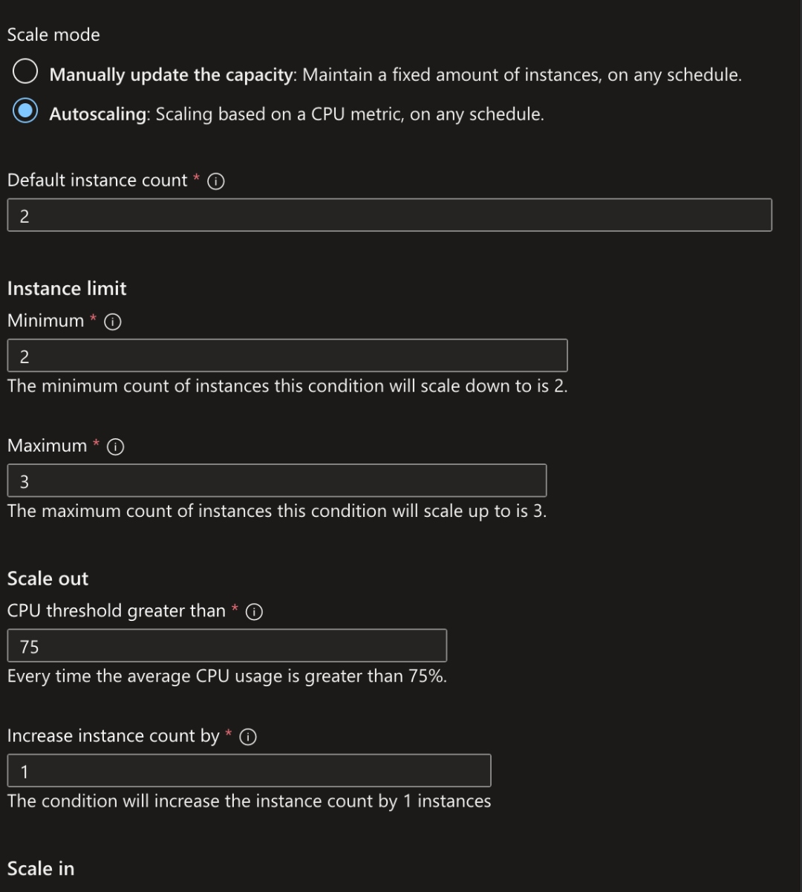

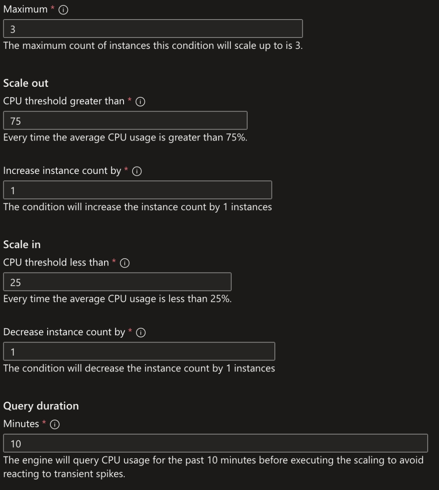

## 2. Reviewed the Configuration Before Deployment

Validation passed. The review confirmed autoscaling with one scaling condition, predictive autoscaling disabled, and the default scale-in policy.

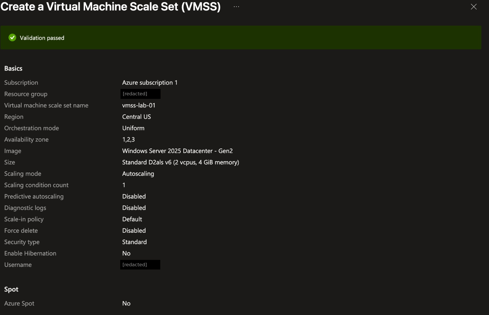

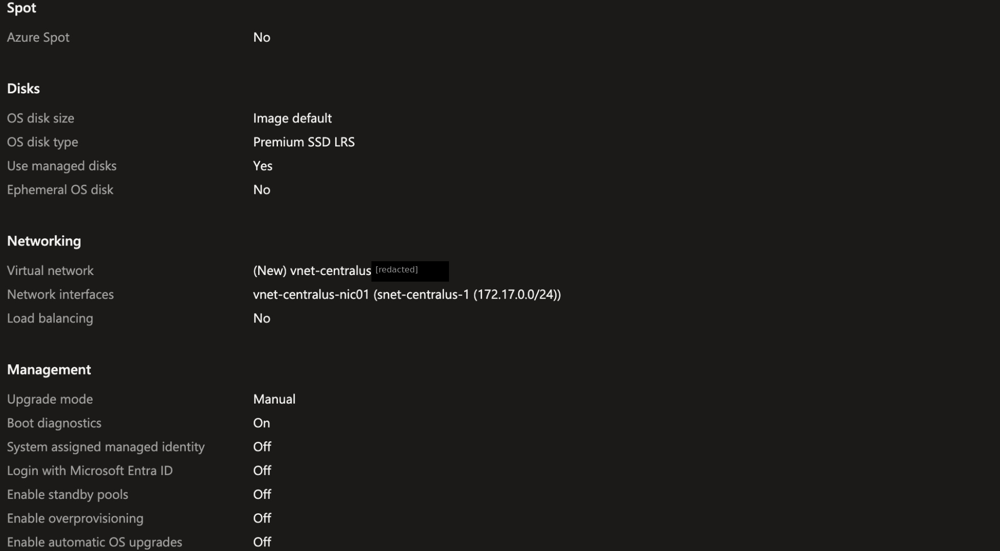

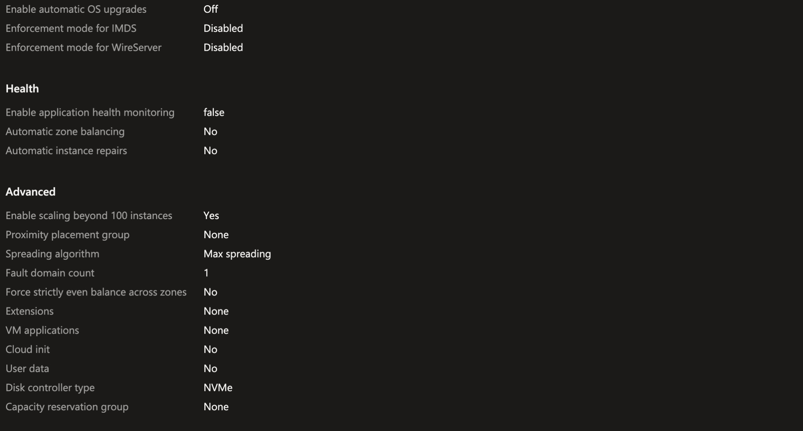

## 3. Deployed and Verified Running Instances

The deployment completed. Start time: 10/17/2026, 8:10:37 AM. The scale set showed Provisioning state: Succeeded, and 2 out of 2 instances running.

| Instance | Computer name | Status | Provisioning state |
|---|---|---|---|
| `vmss-lab-01_1` | `vmss-lab-000001` | Running | Succeeded |
| `vmss-lab-01_2` | `vmss-lab-000002` | Running | Succeeded |

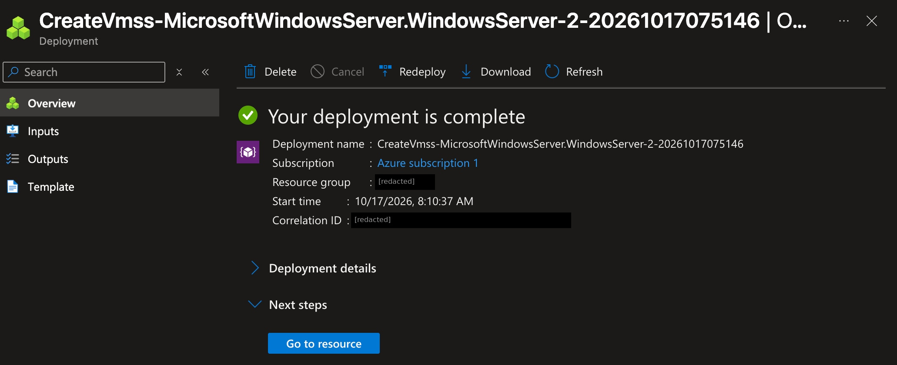

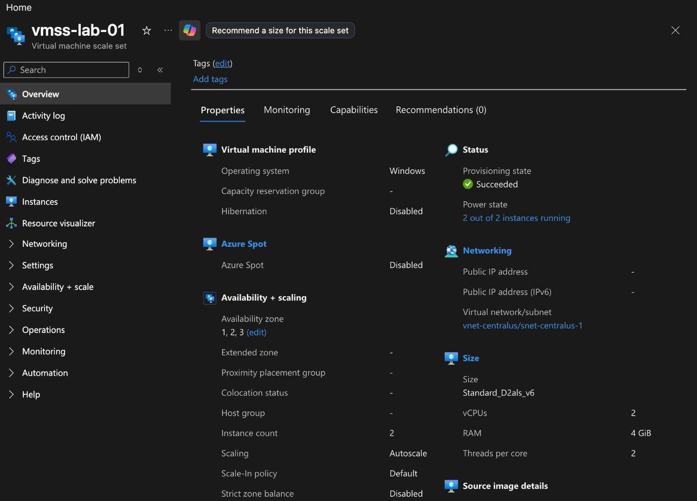

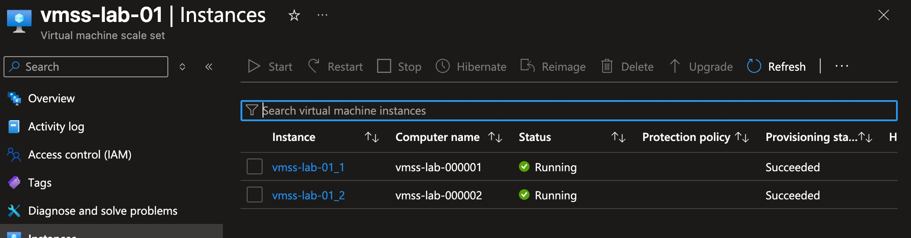

## 4. Verified the Autoscale Rules After Deployment

Confirmed the deployed autoscale setting matched the wizard values. Custom autoscale is selected, predictive autoscale is disabled, and the default condition scales on a metric with limits of 2 minimum, 3 maximum, and 2 default.

| Rule | Metric | Operator | Threshold | Duration | Time grain | Action | Cooldown |
|---|---|---|---|---|---|---|---|
| Scale out | Percentage CPU (Average) | Greater than | 75% | 10 min | 1 min | Increase count by 1 | 5 min |
| Scale in | Percentage CPU (Average) | Less than | 25% | 10 min | 1 min | Decrease count by 1 | 5 min |

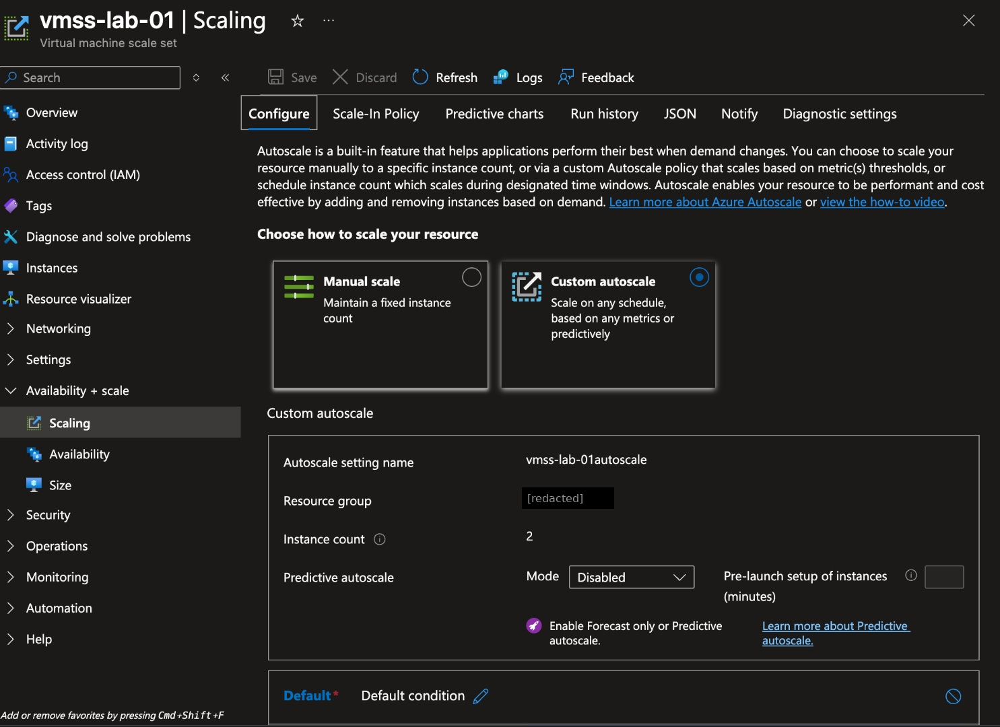

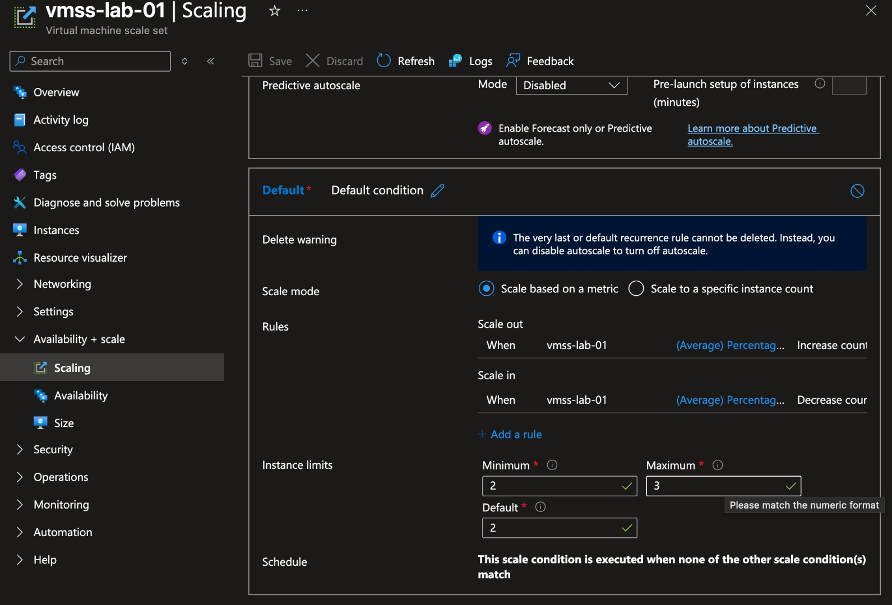

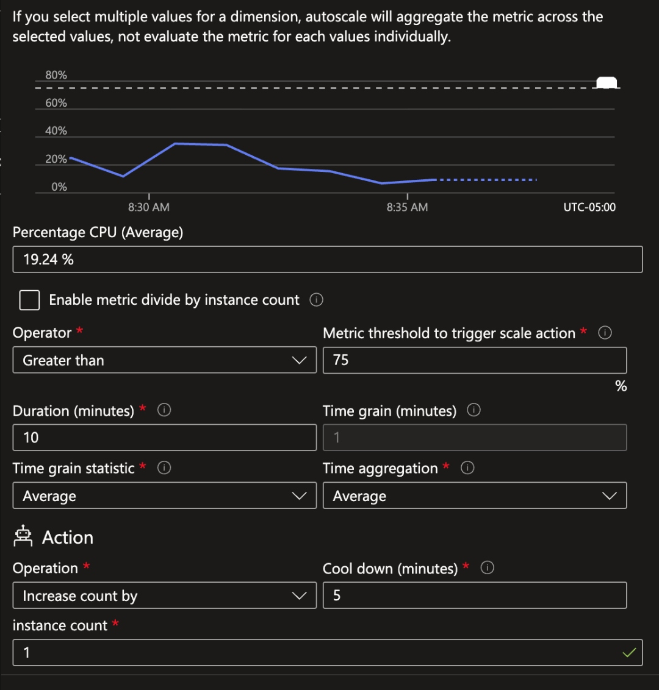

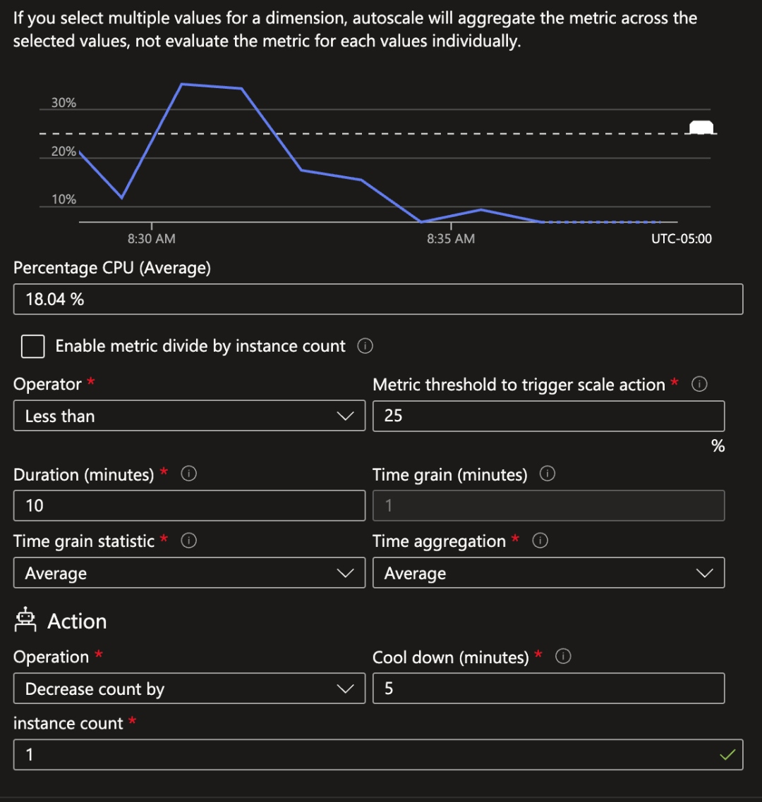

## 5. Reviewed the Run History

The run history is set to the last 1 hour, covering about 7:40 to 8:40 AM (UTC-05:00). It shows one complete scale-out and scale-in cycle.

| Event | Status | Time stamp (Oct 17, 2026) | Observed count |
|---|---|---|---|
| Autoscale scale up initiated / completed | Succeeded | 08:14:58 | 2 to 3 |
| Autoscale scale down initiated / completed | Succeeded | 08:24:27 | 3 to 2 |

The count stayed at 2 for the rest of the window. The chart legend shows a peak observed capacity of 3, which matches the configured maximum.

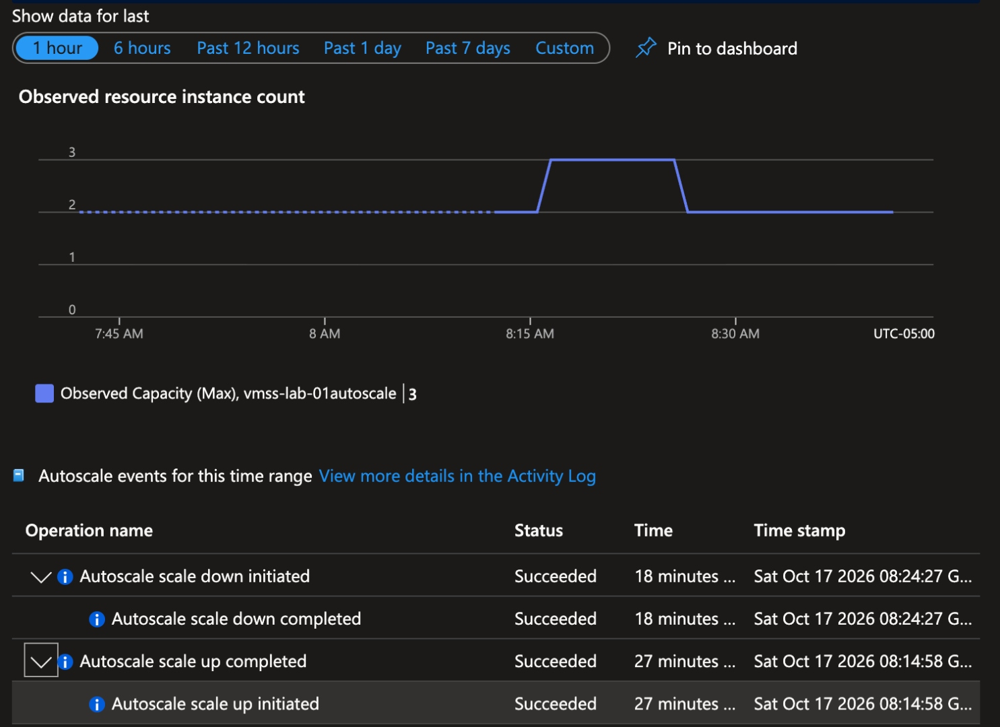

## Results

- The scale set deployed successfully in Central US, with 2 instances running across zones 1, 2, and 3.
- The autoscale limits (2 / 3 / 2) and CPU rules (above 75% out, below 25% in, 10-minute window, 5-minute cooldown) were confirmed both before and after deployment.
- The run history shows the scale set grew to its maximum of 3 instances and returned to its minimum of 2 about 9.5 minutes later. Both events succeeded.
- Afterward, average CPU was below the scale-in threshold (18.04% in the scale-in rule chart), but the count stayed at 2 because the scale set was already at its minimum.

## Cleanup

Cleanup is not documented. No screenshot shows the scale set or its resource group being deleted.

## Lessons Learned and Limitations

- Checked the run history directly instead of assuming the rules worked just because they were configured.
- The cause of the scale-out isn't shown. It happened about 4 minutes after deployment started, and no screenshot shows CPU above 75%. The CPU charts only cover about 8:28 to 8:38 AM, after the events, when CPU stayed around 35% or lower. Instance startup load is a possible cause, but it wasn't verified, and no load test was run.
- The scale-in fits the 25% rule and the 5-minute cooldown, but no screenshot shows the CPU reading at 08:24.
- The minimum instance count works as a floor. Low CPU after the scale-in did not drop the count below 2.
- This lab tested CPU-based autoscale on a small range only. Application load, load balancing, health probes, automatic repairs, and scheduled or predictive scaling were not tested.

## Optional Reference Captures

These are supplementary and not part of the numbered walkthrough.

- [Scaling configuration with wizard defaults before edits](screenshots/reference-vmss-scaling-overview-before-edits.jpg). Shows the original default values (2, 20, 2 instances and 80% / 20% CPU) before they were changed to the lab values.
- [Run history, 7-day view](screenshots/reference-vmss-run-history-seven-day-view.jpg). Shows the same two events and a single spike to 3 on October 17, with no earlier scaling activity that week.
